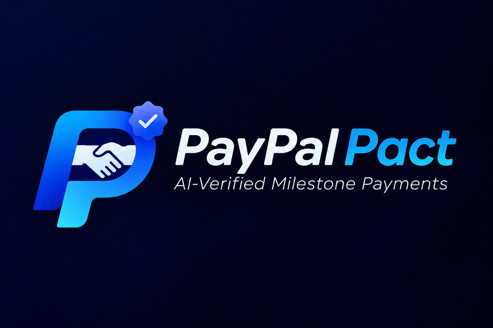

# PayPal Pact

**Work is verified. Progress is paid.**

PayPal Pact is a PayPal AI Hackathon prototype for milestone-controlled payments. A project owner creates a Pact, a Delivery Agent checks objective evidence, and the owner accepts or requests a revision before the corresponding milestone payment can be captured.

The public landing page explains the product and links into Supabase email or Google sign-in. The authenticated workspace flow supports account access, workspace selection and creation, Pact drafts, editable budgets and milestone schedules, and email-bound provider invitations. A provider accepts an invitation by signing in with the invited email; acceptance activates the Pact and grants access only to that Pact. `/walkthrough` is a clearly labelled, repeatable sample journey for judges.



## Judge workflow

1. Open `/walkthrough` and review the generated 30/50/75/100% Pact for the **Brand identity kit**.
2. Select the 50% milestone, which is waiting for owner review.
3. Choose **Request revision** to demonstrate a failed second verification step. Payment remains blocked.
4. Choose **Resubmit evidence** to return the milestone to review.
5. Open **View evidence** and choose **Run evidence check**. The report identifies whether Muse or the deterministic verifier returned the result. The listed evidence is sample metadata, not uploaded files.
6. Choose **Approve & pay $200** to create a PayPal order after an eligible result. With no credentials it returns an explicit sandbox fallback; with sandbox credentials it opens a PayPal approval state.
7. Choose **Open PayPal sandbox approval**, complete buyer approval in the sandbox, return to Pact, and choose **I approved in PayPal — capture payment**. The pending order is retained in the same browser tab for recovery after a refresh; cancelling PayPal approval leaves it unpaid.
8. Switch to **Provider** to see the evidence checklist and resubmission path.
9. Switch back to **Owner**, choose **Request change**, and review the AI-detected out-of-scope mobile-app change order.

The intended product rule is: **the Delivery Agent checks completion; the Project Owner confirms acceptance; PayPal moves only the approved milestone amount.**

## Hackathon alignment

PayPal is central to the product concept and integration boundary. The verified sandbox path uses PayPal Orders/Checkout for milestone payment creation, buyer approval, and capture. Provider payouts, webhooks, and refund/cancellation handling are explicit follow-on boundaries until the relevant PayPal account capabilities are confirmed. AI is used to turn a natural-language brief into milestone acceptance criteria, compare evidence with those criteria, explain missing requirements, and flag scope changes. Owner approval remains mandatory.

The prototype is designed for the hackathon requirements: a working web experience, a public source repository with a license, documented setup, a clear PayPal + AI explanation, and a short end-to-end demo. The Pact Ledger is an inspectable ledger surface for milestone, evidence, decision, and payment events. Sponsor tools are only described as integrations when they are present and verified in the repository.

## Current integration boundaries and limitations

- `/walkthrough` uses seeded client-side state so the judge journey is repeatable without credentials. It is separate from authenticated workspaces.
- The visible approval interaction calls the PayPal order and capture routes. Without credentials those routes return a labelled sandbox fallback; with credentials they call PayPal Sandbox.
- `POST /api/paypal/order` creates a PayPal sandbox order when credentials are configured and returns a deterministic fallback otherwise. `POST /api/paypal/order/[orderId]/capture` captures a configured sandbox order or completes a fallback order.
- PayPal Orders lifecycle: create the order (`CREATED`) with `POST /api/paypal/order`, send the user to the returned PayPal approval link, receive the user at the validated `returnUrl` or `cancelUrl`, then capture the approved order with `POST /api/paypal/order/[orderId]/capture`. Preserve the returned PayPal links and reconcile the final state from webhooks in production. Redirect URLs must be HTTPS (localhost HTTP is allowed for local development).
- `POST /api/pact/verify` uses a validated structured AI Responses API adapter when `AI_API_KEY` (or `MODEL_API_KEY`) and `AI_API_URL` are configured, and falls back to the deterministic verifier when the provider is unavailable or returns invalid output.
- The prototype does not claim legal escrow, autonomous production settlement, production fraud detection, or a legally binding contract. The correct description is **sandbox milestone-controlled settlement**.
- Authenticated accounts, workspace membership, Pact drafts, draft editing, provider invitations, evidence notes and links, owner review, and payment events use Supabase. Private file uploads and voice recordings are not enabled in this release; the UI must not imply that they were processed. Any capability not configured in the current Supabase or PayPal project is shown as unavailable or pending. The walkthrough's evidence and payment state is illustrative and must not be used to protect real transactions.

## Run locally

Account access requires a Supabase project:

1. Create a project at https://supabase.com/dashboard. In its Connect/API settings, find the project URL and publishable (or legacy anon) key. Add these to `.env.local`:

   ```env
   NEXT_PUBLIC_SUPABASE_URL=https://YOUR_PROJECT.supabase.co
   NEXT_PUBLIC_SUPABASE_PUBLISHABLE_KEY=YOUR_PUBLISHABLE_KEY
   APP_URL=http://localhost:3000
   ```

   For legacy projects, `NEXT_PUBLIC_SUPABASE_ANON_KEY` is also supported. Do not put the service-role or secret key in a `NEXT_PUBLIC_` variable.
2. In Supabase SQL Editor, run the files in `supabase/migrations/` in filename order. The third migration adds Pact editing, email-bound invitations, and Pact-specific provider access; the fourth adds persisted evidence review and payment events. Use a new project or check for conflicting objects before applying them.
3. In Authentication URL Configuration, set the site URL to `http://localhost:3000` and add `http://localhost:3000/auth/callback` to the redirect allowlist. For a deployed app, add its HTTPS origin and callback as well.
4. Enable the email provider. To enable Google, create a Google OAuth web client, add the Supabase Google callback URL shown in the Supabase provider settings to Google's authorized redirect URIs, then enter that client's ID and secret in Supabase. Keep Google credentials out of this repository.
5. Set `APP_URL` to the app's public HTTPS origin when deployed. Restart the dev server after adding environment variables. Visit `/`, choose **Sign in** or **Create account**, confirm the email if required, and choose or create a workspace. Creating a Pact opens its detail page, where the owner can edit the draft or choose **Continue setup** to invite a provider. The provider signs in with the invited email, accepts the Pact, and lands on its active detail page.

The public landing page is at `/`; the repeatable sample journey is at `/walkthrough`; authenticated workspace routes live under `/workspace`. Do not deploy seeded walkthrough payment endpoints as production transaction endpoints. A successful PayPal capture is distinct from a provider payout, and the UI must retain that distinction.

```bash
npm install
npm run dev
```

Open http://localhost:3000 (or the alternate port printed by Next.js).

## Demo video

The repository does not include a video binary. For a clean submission capture, record the landing page and the verified `/walkthrough` or authenticated flow at 16:9, then link the published video here. Keep the export framed to the viewport so the README embed has no letterbox bars.

Useful checks:

```bash
npx eslint
npx next build
npm test
```

## Architecture target

- Next.js App Router + TypeScript
- Server-side PayPal Orders, capture, refunds, and webhooks
- Structured AI outputs validated before they can affect Pact state
- PostgreSQL persistence for Pacts, milestones, evidence, approvals, payments, change orders, and audit events
- AG Grid Pact Ledger
- Render-hosted demo and Postman API collection

The target architecture represents sandbox milestone-controlled settlement: the AI verifies objective evidence, the owner approves the outcome, and PayPal moves the approved amount.

## Security boundaries

PayPal credentials and AI keys must stay server-side. Amount limits, milestone totals, owner approval, idempotency, and webhook verification must be enforced by the backend. The Delivery Agent cannot release funds.

## License

MIT. See [LICENSE](LICENSE).
